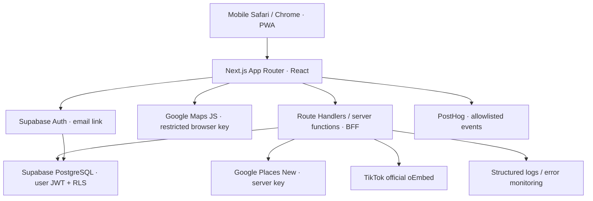

# 00 · System Overview

## 1. Executive architecture summary

SPOTTED adalah mobile-first PWA dengan core loop **Discover → Explore → Save → Find Nearby → Visit**. Satu deployment Next.js cukup untuk UI, BFF, validasi, orchestration, serta integrasi eksternal. Supabase menjadi pemilik akun dan data personal. Google menjadi sumber live place content. Tidak perlu microservices, ORM tambahan, event bus, ataupun database restoran lengkap.

Boundary paling penting: `google_place_id` menghubungkan data provider dengan wishlist dan metadata kurasi. Nama, rating, foto, review, dan opening hours Google tidak disalin menjadi master restoran permanen. Adapter mengembalikan DTO yang nullable, beratribusi, dan membedakan data tidak tersedia dari nilai negatif.

## 2. Status informasi dan scope

**Confirmed information:** PRD v1.0 berstatus Draft for Development, tertanggal 18 Oktober 2026. Launch Jakarta/Tangerang Selatan. FR-01–08 P0 mencakup discovery, detail, combined filters, map, wishlist + nearby, manual TikTok import, auth/profile, dan directions. Browse publik; save/import personal butuh login. Radius 1/3/5/10 km, default 5. Private by default. Tidak ada background GPS.

**Current functionality:** workspace hanya berisi dua catatan design handoff; tidak ada source application yang ditemukan. Figma merupakan desain/prototype dengan data ilustratif, bukan aplikasi yang tersambung API.

**Planned functionality:** seluruh FR P0 di atas. Draft teknis di dokumen ini adalah rekomendasi implementasi, bukan bukti fitur telah berjalan.

**Assumptions:** email magic link; satu engineer full-stack dengan dukungan design/PM/QA; English UI mengikuti Figma sementara dokumentasi Bahasa Indonesia; baseline beta 30–50 orang; public submission UI belum bagian P0.

**Recommendations:** pilih satu set Figma canonical; buktikan cost dan coverage pencarian lewat spike terbatas setelah blueprint disetujui; gunakan staged rollout ke closed beta.

**Future ideas:** `visited`, sharing, personal rating, collaborative wishlist P1; social, AI matching, native app, background notifications P2. Jangan membuat endpoint/UI untuk fitur tersebut pada MVP.

## 3. Pemilihan arsitektur

| Opsi | Delivery MVP | Kompleksitas / biaya operasi | Maintainability / testability | Scalability | Keputusan |
|---|---|---|---|---|---|
| Traditional layered monolith | Cepat untuk CRUD | Rendah | Baik, tetapi perubahan fitur tersebar lintas folder horizontal | Scale satu app | Layak, kurang cocok untuk pembagian feature SPOTTED |
| Feature-based modular monolith | Cepat; satu repo/deployment | Rendah; boundary per fitur | Test pure logic dan adapter terpisah; perubahan lebih lokal | Scale stateless BFF dan database; ekstraksi kelak berdasarkan bukti | **Dipilih** |
| Microservices | Lambat untuk tim kecil | Tinggi: networking, auth antarservice, tracing, deploy | Contract testing dan transaksi lintasservice menambah beban | Independen, belum dibutuhkan | Ditolak untuk MVP |

## 4. System architecture

Browser menghubungi Auth untuk alur login resmi; seluruh domain data application melalui BFF. Server Components memanggil server functions langsung, bukan melakukan HTTP ke `/api` milik sendiri. Route Handler dan Server Component memakai fungsi yang sama. Semua user read/write berjalan dengan user JWT agar RLS tetap berlaku. Admin credential hanya untuk penghapusan auth account dan operasi admin terbatas.

## 5. Final technology decision table

| Teknologi | Tanggung jawab / module | MVP | Alternatif lebih sederhana / trade-off |
|---|---|---|---|
| Next.js App Router + React + TypeScript | Routing, rendering, BFF; seluruh app | Ya | SPA + backend terpisah menambah deploy; tidak perlu |
| Tailwind CSS | Implementasi token/layout Figma | Ya | CSS biasa layak; PRD memilih Tailwind |
| shadcn/ui primitives yang dipakai saja | Dialog, sheet, tabs, controls accessible | Ya, selektif | Native controls jika memenuhi desain; jangan memasang seluruh catalog |
| Zod | Validasi input BFF/provider response kritis | Ya | Manual validation mudah tidak konsisten |
| Supabase JS + SSR helpers | Typed DB operations, cookies, auth | Ya | SQL driver + custom auth lebih banyak kerja; tanpa Prisma |
| PostgreSQL + RLS | Profile, saved IDs, private links, curation | Ya | LocalStorage tidak memenuhi persistence/account privacy |
| Google Maps JS + Advanced Markers | Map, marker selection, location visual | Ya | Tidak mengganti approved map provider |
| Google Places API New | Search, details, review/photo live | Ya | Dataset kurasi saja tidak memenuhi discovery PRD |
| TikTok official oEmbed/player | Preview dengan fallback | Ya | Link-only adalah fallback, bukan pengganti upaya preview |
| TanStack Query | Satu client owner server state, optimistic wishlist | Ya | Context + manual fetch terlihat kecil tetapi race/invalidation lintas enam surface jadi custom code |
| URLSearchParams + React state/context sempit | Search URL dan local UI / ephemeral location | Ya | Tidak perlu Zustand/Redux |
| PostHog | Event funnel + approved exception capture | Ya untuk beta analytics | Allowlist manual event; session replay/autocapture off |
| Vercel | Satu app deployment dan logs | Ya | VPS menambah operasi; plan dan region dipilih kemudian |
| Vitest + Playwright | Pure logic, API/DB integration, core E2E | Ya saat implementasi | RTL ditambah hanya jika perilaku component sulit diuji E2E; tidak otomatis |
| MarkerClusterer | Cluster bila >40 marker visible, termasuk saved | Kondisional | Dengan 20 discovery pins belum perlu cluster; load saat threshold terlampaui |
| Native fetch + AbortController | Places/TikTok adapter dan timeout | Ya | Tidak perlu Axios atau provider wrapper framework |

Gunakan release stabil kompatibel dan lock versi saat Stage 1; blueprint tidak mematok versi package yang belum diuji bersama. Region BFF/DB dipilih berdekatan dan diukur dari pengguna Jakarta.

Rendering server/client mengikuti kemampuan framework, dengan browser API di Client Components. [Dokumentasi Next.js](https://nextjs.org/docs/app/getting-started/server-and-client-components).

## 6. Prinsip implementasi

1. Routes compose; fitur memiliki perilaku; adapter hanya mengetahui provider.
2. Tidak menambah repository interface untuk satu Supabase implementation; `*.server.ts` berisi query langsung yang typed.
3. Domain rules pure: normalization, ranking, distance, marker precedence, URL validation.
4. Tidak membuat base service/generic repository atau event bus untuk cross-feature updates.
5. Trust boundary selalu validate; provider error tidak boleh menghapus wishlist.
6. Perubahan visual mengikuti Figma canonical; architecture tidak mendesain ulang UI.
