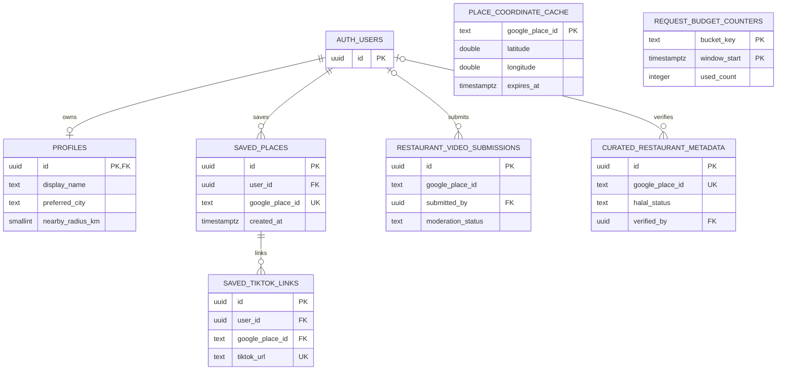

# 03 · Database Architecture

## 1. Model dan ownership

Supabase PostgreSQL menyimpan data yang dimiliki SPOTTED/pengguna. Tidak ada mandatory `restaurants` master table yang menyalin Google catalog. Relasi `google_place_id` ke Google adalah external identity, **bukan foreign key ke tabel restoran fiktif**. Profile tidak menduplikasi email Auth.

PRD mengusulkan lima entity. MVP memakai profiles, saved_places, saved_tiktok_links, curated_restaurant_metadata, restaurant_video_submissions. Dua tabel infrastructure tambahan dibenarkan: coordinate cache untuk nearby tanpa repeated API lookup setiap radius berubah, dan counters untuk distributed rate/global budgets. Bukan fitur produk baru.

## 2. ERD

UK di diagram disingkat; uniqueness komposit definitive berada di tabel berikut. Cache terhubung secara logis melalui Place ID; tidak FK supaya expiry tidak menghapus wishlist. Tabel counter tidak punya hubungan ke data produk.

## 3. Table specifications

Semua timestamp `timestamptz` UTC, primary UUID default database-generated, `created_at` server default `now()`, `updated_at` trigger DB. IDs/ownership/created_at immutable oleh user. Pilih `text CHECK` untuk enums kecil agar perubahan value tidak membutuhkan database enum lifecycle.

### profiles

| Column | Tipe / constraint |
|---|---|
| id | uuid PK FK auth.users(id) ON DELETE CASCADE |
| display_name | text NULL; jika isi trim length1–50; NULL selama onboarding |
| avatar_url | text NULL; nullable PRD field, tidak ada upload MVP; jangan arbitrary image proxy |
| preferred_city | text NOT NULL DEFAULT 'jakarta'; CHECK IN ('jakarta','tangsel') |
| nearby_radius_km | smallint NOT NULL DEFAULT5 CHECK IN (1,3,5,10) |
| created_at, updated_at | timestamptz NOT NULL |

Privacy controls MVP fixed private + foreground/manual location; tidak perlu jsonb `preferences` tanpa schema. Tidak menyimpan GPS consent sebagai permission permanen karena browser permission bisa berubah. Private policy tampil informasional sesuai Figma. Jika pengaturan privasi baru disetujui, tambahkan column eksplisit.

### saved_places

| Column | Tipe / constraint |
|---|---|
| id | uuid PK |
| user_id | uuid NOT NULL FK auth.users(id) ON DELETE CASCADE |
| google_place_id | text NOT NULL CHECK nonempty length<=255, no control/slash/whitespace |
| created_at, updated_at | timestamptz NOT NULL |

`UNIQUE(user_id,google_place_id)` mencegah duplicate walau concurrent requests. Index `(user_id,created_at DESC,id DESC)` melayani pagination/sort. PRD model memiliki `status want_to_go/visited`, tetapi scope menetapkan Visited P1. **Rekomendasi:** omit status MVP; tidak membuka PATCH visited endpoint. Jika PM memilih compatibility column, DEFAULT want_to_go dan tidak ada UI visited, tetap harus dicatat ADR amendment.

### saved_tiktok_links

| Column | Tipe / constraint |
|---|---|
| id | uuid PK |
| user_id | uuid NOT NULL |
| google_place_id | text NOT NULL |
| tiktok_url | text NOT NULL canonical HTTPS video URL, <=2048 |
| created_at | timestamptz NOT NULL |

Composite FK `(user_id,google_place_id) REFERENCES saved_places(user_id,google_place_id) ON DELETE CASCADE`; menjamin link tidak menunjuk saved place akun lain. `UNIQUE(user_id,google_place_id,tiktok_url)` untuk retry aman. Index unique tersebut juga melayani fetch link per place. Canonical video ID digit dan exact host/path CHECK pada DB; canonical URL tidak membawa tracking query. URL short link harus di-resolve sebelum persistence.

**Assumption lifecycle:** remove saved place menghapus private links terkait, sesuai desain Delete account tetapi belum diputuskan untuk remove single place. Rekomendasikan label konfirmasi menyebut links ikut dihapus; owner harus menyetujui sebelum mutation dibuat. Menghapus hanya satu link tidak menghapus saved place. Setelah hard delete tidak ada Undo palsu tanpa retention policy.

### curated_restaurant_metadata

| Column | Tipe / constraint |
|---|---|
| id | uuid PK |
| google_place_id | text NOT NULL UNIQUE |
| speciality | text NULL <=240, kurasi bersumber |
| speciality_source | text NULL safe HTTPS source; wajib ketika speciality diisi |
| halal_status | text NOT NULL DEFAULT 'not_verified'; CHECK certified/contains_non_halal/not_verified |
| halal_source | text NULL HTTPS; wajib status!=not_verified |
| halal_verified_at | timestamptz NULL; wajib status!=not_verified |
| halal_valid_until | timestamptz NULL, >verified_at; expiry resmi jika tersedia |
| menu_url | text NULL HTTPS official/authorized menu |
| menu_source | text NULL; wajib bila menu_url diisi |
| verified_by | uuid NULL FK auth.users(id) ON DELETE SET NULL; admin trace |
| created_at, updated_at | timestamptz NOT NULL |

Tidak ada menu prices fixture/permanently copied Google fields. Menu MVP adalah link resmi; structured items hanya jika legal source dan requirement disahkan. UI effective halal `not_verified` jika bukti kadaluwarsa/dicabut; source dan reviewed date terlihat. Untuk sertifikasi tanpa expiry jelas, admin review interval 90 hari adalah rekomendasi, bukan jaminan validitas resmi. Public response tidak mengekspos verified_by. Unique Place ID mencukupi; jangan menambah index tiap column tanpa query evidence.

### restaurant_video_submissions

| Column | Tipe / constraint |
|---|---|
| id | uuid PK |
| google_place_id | text NOT NULL |
| submitted_by | uuid NULL FK auth.users(id) ON DELETE SET NULL |
| tiktok_url | text NOT NULL canonical HTTPS |
| moderation_status | text NOT NULL DEFAULT 'pending', CHECK pending/approved/rejected |
| moderated_by | uuid NULL FK auth.users(id) ON DELETE SET NULL |
| moderated_at | timestamptz NULL; required approved/rejected |
| created_at | timestamptz NOT NULL |

`UNIQUE(google_place_id,tiktok_url)` untuk satu public record/video/place; partial index `(google_place_id,created_at DESC) WHERE moderation_status='approved'`. Private links **tidak otomatis di-copy** ke sini. Admin-only seed/review untuk beta; user contribution UI/API deferred sampai scope disahkan. Approved public response hanya id/place/url, bukan submitter. Account deletion rekomendasi: hapus submissions milik user, termasuk approved, untuk memenuhi ekspektasi penghapusan; review bila PM menginginkan retention dengan dasar terpisah. Server function tidak boleh menggunakan `SET NULL` sebagai alasan mempertahankan kontribusi secara diam-diam.

### private.place_coordinate_cache

| Column | Tipe / constraint |
|---|---|
| google_place_id | text PK |
| latitude, longitude | double precision NOT NULL finite/range CHECK |
| fetched_at | timestamptz NOT NULL |
| expires_at | timestamptz NOT NULL; fetched_at<expires_at<=fetched_at+interval '30 days' |

Cache hanya koordinat restoran, bukan lokasi pengguna. Default TTL rekomendasi 29 hari memberi margin dari maksimum30. Read harus filter `expires_at>now()`; expired tidak dipakai untuk nearby meskipun cleanup belum berjalan. Scheduled SQL cleanup harian menghapus expired; backup cache tidak diaktifkan, jangan menyertakan cache pada product exports. Backup/PITR bisa mempertahankan provider data melewati expiry: production owner perlu memastikan retention yang compliant atau pindahkan cache ke storage ephemeral tanpa backup. Bila tidak dapat dibuktikan, **jangan persist cache**; resolve coordinate on demand dan sesuaikan budget. Cache bukan syarat data correctness: miss/failure → unknown coordinate.

Public roles tidak punya direct grants pada schema private; koordinat diakses server-only restricted RPC yang memverifikasi daftar ID milik user untuk wishlist. Service-only cache upsert menerima provider result dari adapter, bukan user input. Caching exception hanya berlaku jika terms billing account sesuai, lihat integrasi.

### private.request_budget_counters

`bucket_key text`, `window_start timestamptz`, `used_count integer CHECK>=0`, `expires_at timestamptz`; composite PK `(bucket_key,window_start)`. Atomic UPSERT/increment/check; daily provider/action budgets dan rolling/minute app limits. Server-only function, revoke public execution. Jangan simpan raw IP: gunakan daily salted hash; hapus bucket lewat cleanup <=48 jam untuk short limits. Global daily bucket tidak mengandung identitas. Counter unavailable → fail closed untuk paid provider endpoint, personal DB reads tetap dapat berjalan. Ini state infrastruktural kecil, bukan analytics user tracking.

## 4. RLS dan privilege matrix

Enable RLS untuk seluruh application table termasuk yang hanya diakses server. RLS + grants + column allowlist bersama-sama diperlukan. Kunci service role bypass RLS; tidak boleh menjadi jalur default wishlist. [Supabase RLS reference](https://supabase.com/docs/guides/database/postgres/row-level-security).

| Table | anon | authenticated owner | other user | admin/trusted server |
|---|---|---|---|---|
| profiles | None | SELECT own, UPDATE allowed cols; bootstrap INSERT own via trusted flow | None | Account cleanup only |
| saved_places | None | SELECT/INSERT/DELETE own; no update ownership/ID | None | No normal bypass |
| saved_tiktok_links | None | SELECT/INSERT/DELETE own + composite FK; no arbitrary update | None | Cleanup only |
| curated metadata | SELECT public permitted columns | Same read; no write | Public read only | Validated admin write |
| video submissions | SELECT approved public columns only | Public read; no submission writes MVP | Public approved only | Insert/review/delete |
| coordinate cache | None | None direct; own-ID RPC via BFF | None | Restricted cache read/upsert/cleanup |
| budget counters | None | None | None | Restricted consume RPC/cleanup |

Definitive policy predicates:

- Own SELECT/DELETE: `(select auth.uid()) = user_id` (profiles uses id).
- INSERT WITH CHECK: same owner predicate; FK validates link membership.
- Profile UPDATE USING and WITH CHECK both own ID; grants restrict name/city/radius only.
- Public videos SELECT USING `moderation_status='approved'`; direct SELECT column grant excludes submitted_by/moderated_by. No default grants for disallowed operations.
- Public curation read uses column grants or safe projection; do not create default security-definer view bypassing RLS. Use security-invoker view if needed and verify column exposure.
- Admin authority from server-controlled app_metadata/allowlist, never editable user_metadata or profile field. Admin UI not required MVP; access via explicit trusted operator process.

Security-invoker transaction functions use fixed/empty search_path with fully qualified names and minimal execute grants. Cache/budget admin functions with elevated privilege must validate inputs, fixed search_path, no dynamic SQL, only trusted role execution. Every function is part of RLS threat-model tests, not implicit exception.

## 5. Migrations dan deletion

Implementation sequence: create tables/checks/FKs/indexes → enable RLS/revoke defaults → grant intended columns → policies → atomic import/cleanup/budget functions → idempotent profile bootstrap → generated TS types → test real local DB with anon/A/B/admin JWTs. Migration and matching security tests shipped in same PR. No production SQL console-only schema changes.

Deletion: recent-auth gate → remove user's public submissions → hard-delete auth user, letting FKs cascade profile/saves/links → confirm auth deletion → clear cookies/cache/analytics identity. A nontransactional Auth Admin call can fail after submission cleanup; retry safely and do not report account deleted until auth user absent. No avatar uploads MVP, therefore no Storage object cleanup requirement. Existing tokens may remain valid until expiry; authorization must fail when auth user/profile gone, and RLS must prevent recreation. Test this explicitly. Backup removal follows disclosed retention policy; account UI must not promise instant purge from backups if not implemented.

Forward migration diprioritaskan; production rollback biasanya mengembalikan deployment application dengan schema backward-compatible. Destructive DB rollback memerlukan backup/restore plan dan review dampak kehilangan data. Jangan seed data pribadi production ke preview; gunakan fixtures sintetis berlabel.
