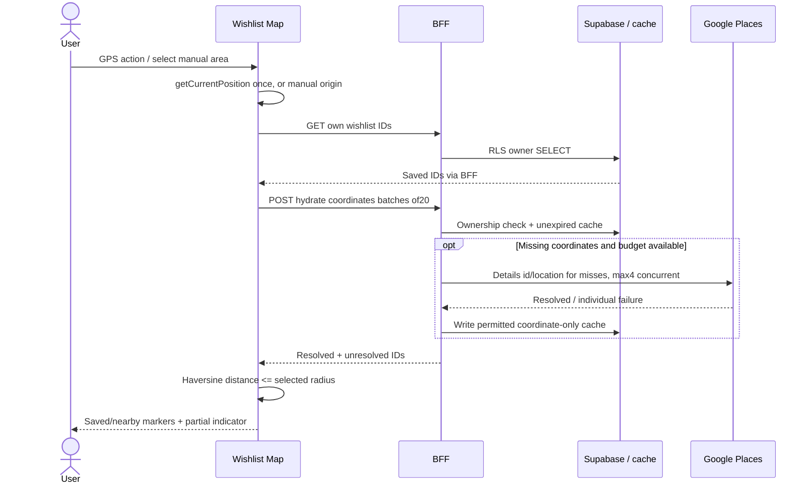

# 04 · Integrations, Map & Nearby Wishlist

## 1. Google data ownership dan provider policy

Data persisten utama adalah Place ID, pilihan user, private links, dan metadata kurasi yang sumbernya sah. Google content dipakai live untuk display, tidak dijadikan catalog database atau permanent image library. [Places policies](https://developers.google.com/maps/documentation/places/web-service/policies) membedakan penyimpanan ID dan content serta mewajibkan attribution.

| Data | Storage recommendation | Boundary |
|---|---|---|
| Place ID | Persist di wishlist/curation/links | External identity; validasi/re-resolve ketika provider mengindikasikan ID pindah |
| Google restaurant coordinates | Optional coordinate-only expiring cache | Terms non-EEA mengizinkan sampai30 hari; default29; gating billing address + backup policy |
| Name, address, rating, counts, opening hours | Request/display session only | No persistent DB/CDN/LocalStorage/query persistence |
| Review/photo content, attribution, photo names | Fetch when displayed, no persistent cache | Photos/reviews tetap membawa authorship; jangan menyimpan expiring photo resource sebagai asset permanen |
| User GPS/manual map origin | Ephemeral browser state; request body bila dibutuhkan | No DB/history/analytics/raw request logging |
| Curated speciality/menu/halal evidence | Persist source + verified date | Admin-controlled, bukan ditebak dari Google types/video |
| TikTok canonical URL | Persist personal owner data | Preview tidak membuat content publik; no media download |

Ketentuan yang diverifikasi: **Places API Legacy/New §14.3** pada [current service-specific terms non-EEA](https://cloud.google.com/maps-platform/terms/maps-service-terms). Pengecualian koordinat bukan izin menyimpan seluruh response. Billing address SPOTTED belum dikonfirmasi, jadi cache di-enable hanya setelah terms yang berlaku disahkan. Ini constraint teknis; compliance production belum diklaim selesai.

TanStack Query dipakai sebagai active render state dan in-flight deduplication, bukan store offline provider data. Set `staleTime:0`, disable background polling/window-focus refetch untuk paid provider queries, no persistence, no speculative prefetch. Pindah renderer List/Map pada context yang sama mempertahankan snapshot aktif; meninggalkan context membuang response. Jangan memakai arbitrary 24h/30d TTL untuk rating/nama/review. Review implementasi transient state dengan policy provider sebelum launch.

## 2. Places adapter dan field masks

Adapter native fetch hanya menghubungi `https://places.googleapis.com/v1/…`; hostname, operation dan mask dimiliki server, tidak boleh dikendalikan request. Error mapping memisahkan no matches, quota, provider failure, place removed. Timeout dan fan-out budget selalu diterapkan sebelum request.

| Operation | Fixed mask recommendation | Trigger dan cost consideration |
|---|---|---|
| Text/Nearby candidates | `places.id,places.displayName,places.location,places.rating,places.userRatingCount,places.priceLevel,places.primaryType,places.types,places.shortFormattedAddress,places.photos,places.googleMapsUri,places.businessStatus,places.attributions` | Search/Explore/SearchThisArea; card rating+count sudah membuat paid search field tier lebih tinggi |
| Open Now variant | Candidate mask + `places.currentOpeningHours` | Hanya saat filter active; unknown opening data tidak dianggap closed |
| Place overview | `id,displayName,location,rating,userRatingCount,priceLevel,types,shortFormattedAddress,formattedAddress,photos,googleMapsUri,businessStatus,currentOpeningHours,websiteUri,attributions` | Open detail, bukan tiap card |
| Reviews section | `id,rating,userRatingCount,reviews,googleMapsUri,attributions` | First opening review tab only; tier review lebih mahal |
| Wishlist coordinates | `id,location,businessStatus` | Cache miss pada own saved IDs; tidak perlu rating/review |
| Wishlist visible cards | Search-equivalent fields tanpa `places.` prefix untuk Details | Progressive visible page; reuse aktif context bila sudah resolved |

Text Search `nextPageToken` hanya diminta bila pagination diputuskan; tidak memakai `*`. Review mask/tier dan atribut yang tersedia per method saat spike; jangan meneruskan client field masks. [Choose fields](https://developers.google.com/maps/documentation/places/web-service/choose-fields) dan [usage/billing](https://developers.google.com/maps/documentation/places/web-service/usage-and-billing) menjadi referensi verifikasi, tanpa menebak harga unit.

Search dan Nearby memakai payload berbeda. [Text Search](https://developers.google.com/maps/documentation/places/web-service/text-search) cocok untuk dish/name/area queries; [Nearby Search](https://developers.google.com/maps/documentation/places/web-service/nearby-search) untuk center/radius dan supported type. Jangan mengirim parameter `openNow/minRating` ke Nearby seolah semua parameter Text Search tersedia.

## 3. Search, filters, ranking semantics

1. Query nama/hidangan/minuman/area menjadi textQuery dengan area restriction/bias yang didukung provider; server tetap mengecek result terhadap configured launch area dan requested radius/bounds. Current-location di luar launch area menampilkan unsupported-area state + manual selection, bukan diam-diam memberi Jakarta berlabel nearby.
2. Category mapping: Coffee → cafe/coffee-compatible type; Japanese/Korean/Indonesian/Western → provider supported cuisine type atau explicit text query; Matcha/Brunch/Dessert → keyword strategy bila tidak ada type yang cocok. Final mapping diuji pada sample Jakarta/Tangsel; jangan mengklaim Matcha verified hanya karena ada cafe type.
3. Server post-filter satu candidate snapshot: cuisine evidence, rating minimum, selected price enums, openNow true, verified halal evidence valid, dan straight-line radius. Unknown field tidak dibuang saat filter terkait off; saat filter on, unknown tidak memenuhi. Misal halal `not_verified` ≠ contains_non_halal. UI menjelaskan data unknown dikecualikan oleh filter aktif.
4. Radius filter/Nearest membutuhkan origin. Server menghitung distance sementara untuk filtering/sort dari origin request, tidak menyimpannya. Client menghitung ulang untuk display/nearby marker menggunakan pure formula sama; tidak mempercayai client-supplied distance.
5. Saved Only: login required; hydrate/filter **seluruh daftar own saved IDs** secara progressive, bukan sekadar saved IDs yang muncul dalam20 candidate Google. Query nama hanya diterapkan pada name/cuisine/area yang tersedia dalam live hydrated wishlist; field unknown ditandai incomplete. Query tidak mencari caption/video. Jangan memberi count final sebelum semua hydration selesai.
6. Provider cap20 adalah default bounded snapshot. Jika post-filter menghasilkan0, tampilkan tidak ada hasil dalam kandidat/area tersebut + reset/search area; jangan menjanjikan pencarian exhaustive atau diam-diam melakukan unlimited fan-out.

Recommended weighted formula confirmed PRD: `score=(v/(v+100))*R + (100/(v+100))*C`; C mean rating dari rated candidates **sebelum UI post-filter**, m100. Unrated tidak diberi rating0; sort rated dahulu, unrated di akhir; bila semua unrated, preserve provider relevance. Highest Rated: rating desc, count desc, ID asc; Most Reviewed: count desc, rating desc, ID asc; Recommended: score desc, count desc, ID asc; Nearest: unrounded distance asc, rating desc, ID asc; unknown distance terakhir. Locale/case normalization konsisten. Top Rated selalu menyebut kandidat di area yang dicari, bukan ranking resmi seluruh kota.

Menu menggunakan curated official link, tanpa menampilkan dummy item/price. Google reviews subset ditampilkan utuh dengan author/link/attribution, tanpa fabricated totals. Directions default Google Maps universal URL dengan `api=1`, `destination` dan `destination_place_id`; tidak butuh routing API. Apple Maps hanya bila tujuan bersumber independen/kurasi atau flow compliant sudah diverifikasi; jangan mengekspor Google coordinates ke map provider lain secara otomatis. Web Google Maps adalah MVP fallback. [Maps URLs](https://developers.google.com/maps/documentation/urls/get-started).

## 4. Map discovery flow

Map SDK dimuat satu kali per session ketika dibutuhkan. Gunakan map ID untuk Advanced Markers, browser key restricted referrer + Maps JS API; server Places key berbeda. Tidak membuat map instance baru setiap marker state berubah. Components own marker lifecycle dan listeners; cleanup unmount untuk mencegah memory leak.

Pisahkan `cameraViewport` dari `committedSearchArea`. Pan/zoom hanya memperbarui camera; idle membandingkan normalized bounds untuk menampilkan Search This Area. Default area rounding 4 decimal degrees untuk dedup adalah rekomendasi; exact origin tetap hanya memory. Click mengambil snapshot camera dan filters saat itu, abort previous search, reserve budget lalu fetch. Hanya response revision terbaru mengganti markers. Loading mempertahankan markers lama dan menandai refresh; error mempertahankannya dengan Retry. Tidak ada auto-paid request saat drag/zoom/GPS repaint.

Area discovery max20 candidates/request beta; marker map terdiri dari candidates dan saved IDs resolved, dedup berdasarkan Place ID. Radius query 1–10km bukan zoom-derived unlimited radius. Bila viewport terlalu luas, tombol meminta zoom-in atau bound ke launch area; jangan query radius50km otomatis. Text query restriction mengikuti rectangle; Nearby menggunakan circle yang mencakup viewport lalu post-filter bounds. Tombol tidak mencari seluruh kota secara exhaustive.

Cluster bila visible marker>40, terutama wishlist besar; load cluster library hanya saat perlu. Saved/nearby count pada cluster dapat dihitung dari loaded members, selected marker dikeluarkan/di-focus sesuai SDK capability. Animation tidak pada semua cluster children sekaligus. Attribution Google/author tidak tertutup bottom sheet/navigation; map failure mempunyai list alternative yang sama.

## 5. Nearby Wishlist complete flow

`navigator.geolocation.getCurrentPosition`, user-triggered, one-shot; no watchPosition/background worker. Recommended timeout10s, maximumAge60s, high accuracy off initially; report permission denied/timeout/unavailable separately. Do not poll location on every render/focus. Refresh via explicit current-location button. Manual city/area has clear origin label; manual city centroid is approximate and cannot be called user's actual position. Accuracy radius larger than selected threshold → show approximate distance, do not promise boundary precision.

Coordinates resolved from current Places responses or valid cache. Hydrate all IDs progressively; reuse coords in active memory. Missing/not-found/quota IDs stay in saved list as unresolved, are not drawn at `(0,0)`, and cannot count as outside radius. Show `N nearby; X places not checked` until complete. Count is always resolved nearby count, not total inferred from top candidates. Cards hydrate only when visible; coordinate fan-out remains bounded by global budget. Changing radius recalculates locally, **zero provider calls** once coordinates are available. Reopening after expired cache may require paid lookups; budget explicitly accounts for this.

Haversine: radians; earth mean radius6371008.8m; `a=sin²(Δlat/2)+cos(lat1)cos(lat2)sin²(Δlng/2)`; clamp a to[0,1]; `d=2R*atan2(sqrt(a),sqrt(1-a))`. Nearby inclusive `d<=radiusKm*1000` using unrounded d; rounding only display. Straight-line, not route distance/travel time. Unit tests boundary1/3/5/10km, identical coords, invalid/NaN, and mobile GPS precision.

**Trade-off:** client computes nearby cheaply without sending user origin for wishlist-only map; no PostGIS or server GPS history. Server computes transient distance only for search/radius filters. Large saved lists could justify PostGIS later only if storage terms/data source permit and real load evidence exists.

## 6. Marker states and motion

Effective display priority **selected > nearby > saved > regular**. `saved` membership persists underneath selection. Nearby requires saved + known origin + valid coordinates + d<=r; unknown location is saved, with nearby status unknown. Selection does not overwrite membership. Key marker by Place ID and update properties in place; map/list query snapshot remains synchronized.

Nearby uses Figma highlight plus short animation recommended3 cycles over<=2.4s on transition into nearby; no infinite pulse. Record animated IDs for current session/area so panning/remounting does not continuously restart. Re-selecting marker stops motion. `prefers-reduced-motion` renders static highlight; accessible name describes saved/nearby/selected and approximate distance. Avoid animating many simultaneous pins; animate at most3 visible nearby markers, static highlights for remainder. Exact duration/cap is engineering recommendation pending motion acceptance, not redesign.

## 7. TikTok integration and trust boundary

1. Require authenticated user, paste URL. Parse with URL API; HTTPS only, no credentials, nondefault port, IP host, fragment, or >2048 chars.
2. Allow exact `www.tiktok.com`/`tiktok.com` video paths `/@creator/video/[digits]` and known official short-link hosts `vm.tiktok.com`, `vt.tiktok.com`, plus recognized `/t/[token]`. Do not use `endsWith('tiktok.com')`; `eviltiktok.com` and `tiktok.com.evil.test` fail.
3. Short-link resolver at most3 redirects/5s, revalidate every target, DNS/public IP policy and allowlisted HTTPS host on every hop, no redirects to internal/link-local/metadata IPs. No URL submitted as generic fetch target. If redirect is unsupported/unresolvable, ask canonical URL and keep input; no scraping. Strip tracking params after canonical video ID resolution.
4. Fetch fixed official oEmbed endpoint with encoded canonical URL. Bound response<=256KiB; parse expected JSON fields; no `dangerouslySetInnerHTML` from arbitrary oEmbed HTML. Build supported embed/player from verified numeric ID; official script loaded only on user tab/preview interaction and consent policy. Exact official embed mechanism validated in spike, no invented iframe domains.
5. Public preview may fail for removed/private/region unavailable video. Return fallback Watch on TikTok with canonical URL; confirmation/search flow remains usable. Display title/creator only when actually supplied. No caption scraping or AI restaurant inference.
6. Restaurant selector calls same search endpoint; user must confirm exact branch/place ID. URL change clears confirmation; restaurant change requires reconfirmation. No location matching guess.
7. Save request carries URL/place/confirmed; server validates again; atomic RPC creates wishlist+link. Success updates authoritative wishlist and links caches. Duplicate import idempotent; same video linked to different restaurant allowed per user confirmation, since one video may cover multiple places.
8. Public video tab merges approved catalog plus own private section, visually separated per Figma. Anonymous users receive public videos only. No API for unrestricted TikTok video search.

Official preview mechanics and removed-video behavior: [TikTok Embed Videos](https://developers.tiktok.com/docs/en/embed-videos). This design stores links; it does not download videos/thumbnails into SPOTTED assets. Unavailable thumbnail can be omitted to avoid additional untrusted image proxy surface.
